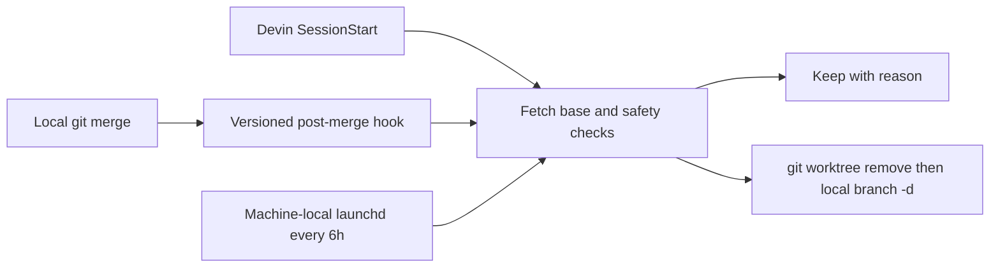

# Task worktree lifecycle

A worktree is one temporary checkout for one task. Its creator folds it when the
task is merged or abandoned. Abandonment alone never makes automatic deletion
safe: retain or recover unmerged commits before deciding manually.

Run `bash tools/worktrees.sh` to fetch `origin/main` and sweep. Use `--dry-run` to
fetch and inspect without removal, or `--base origin/<branch>` for another base.
Python 3 and Git are required on macOS or Linux.

The sweep prints **keep** or **fold** with a reason for every registered worktree.
It keeps the primary checkout, locked or detached checkouts, unreadable/missing
checkouts, dirty/untracked files, changed branch tips, and branches that are not
ancestors of the freshly fetched base. Squash-merged branches stay for human
review. Fetch failure prevents all folding. It does not prune registrations.
It uses only `git worktree remove` without force, followed by `git branch -d` for
the local branch. Remote branches remain. A repository-common advisory lock
serializes cooperating sweeps; it does not lock arbitrary Git operations by other
agents. The state is rechecked immediately before removal, and Git still performs
its own removal checks. Lock an intentionally retained task tree with
`git worktree lock <path>` before using another session against it.

## Entry points and scope

- `tools/git-hooks/post-merge` runs after local merges. Existing tracked security hooks
  are preserved. Compatibility wrappers call existing native hooks when present.
  Native hooks are machine-local and are not copied into cloud sessions.
- `.devin/config.json` invokes the sweep at SessionStart. Only the committed,
  merged repository config reaches fresh remote clones; a Mac's hooksPath or
  launchd job does not configure cloud sessions. Remote execution is unverified
  until observed in a fresh Devin session. A fetch/auth failure keeps everything.
- The local installer sets `core.hooksPath` to this checkout's `tools/git-hooks` without
  deleting or replacing native hooks. Git config is local, not committed.
- The authorized Mac shared job `com.yosh.worktree-lifecycle` loops over an
  explicit allowlist every 21,600 seconds. It skips repos with changes, concurrent
  sweeps, missing scripts, or a different script hash. It does not purchase
  capacity or start paid agents. Local hooks operate only while these files are
  present in the checked-out revision; the job reports missing files otherwise.
- Logs: `~/.config/ai-development/worktree-lifecycle/sweep.log`; per-run output
  includes each worktree decision. Stop with
  `launchctl bootout gui/$(id -u)/com.yosh.worktree-lifecycle`. Restore the recorded
  prior hooksPath (or unset its local value) to stop merge-triggered runs.
  Do not remove or reconfigure the independent StoryDeck job.

## Human acceptance

Target: this Mac, Terminal, Git and Python 3; the exact tested versions and agent
results are recorded in the rollout task/report. No product UI is changed, so a
device-screen test is inapplicable; review the terminal decisions and PR instead.

Prerequisites: read this PR; keep existing work unchanged; use a disposable local
bare remote and fixtures for removal checks. Do not create test commits in a live
product worktree.

1. Run `python3 tools/test_worktrees.py`. Expect all safety and deletion tests to
   pass, including fetch failure, detached HEAD, dirty/untracked files, lock,
   unmerged and squash merges, concurrent sweeps and repeated runs.
2. Run `bash tools/worktrees.sh --dry-run` in this repository. Expect a fresh fetch
   and one reason for each checkout, with no removal.
3. Inspect `.devin/config.json`, `tools/git-hooks`, local hooksPath, and the Mac job's
   allowlist and loaded state. Expect existing hooks to remain intact and only
   approved clean repositories in the allowlist.
4. After the PR merges, optionally inspect a fresh Devin SessionStart log. Expect
   sweep decisions or a safe fetch-failure report, with no forced removals. This
   remote behavior has not yet been observed.

Pass: all protected fixtures remain and only the clean ancestor fixture folds;
no remote branch is deleted. Fail: any protected checkout disappears, a fetch
failure still removes a checkout, existing instructions/hooks change, or a
scheduled run acts outside its allowlist. Human acceptance: **not executed**.
